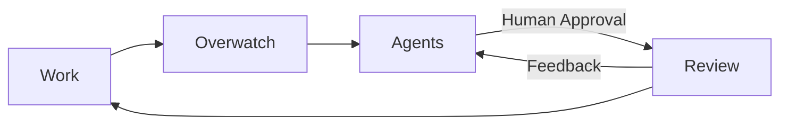
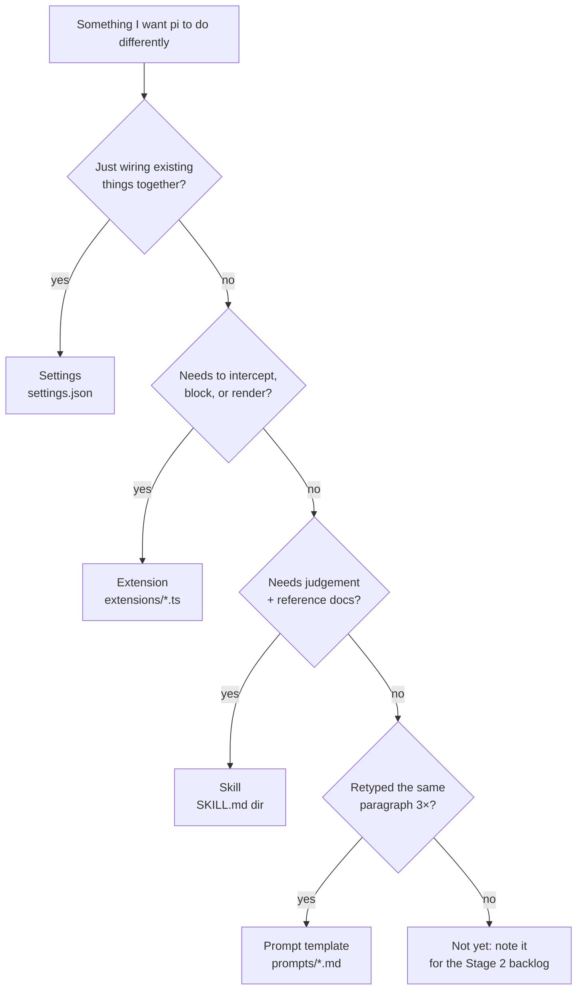

---
tags:
  - WIP
date: "2026-06-18"
title: ai_workspace
---

> [!faq]- Disclaimer: 
> This setup is prone to frequent iteration given the speed at which this industry and tooling are constantly changing as of recent.

# Background

# Components

The broad picture of this workspace is composed of the following:

- LLM
- MCP Servers
- Agents/Harnesses

## LLMs

## MCP Servers

## Agents/Harnesses

## Workflows

aaaaa

# References

- 
