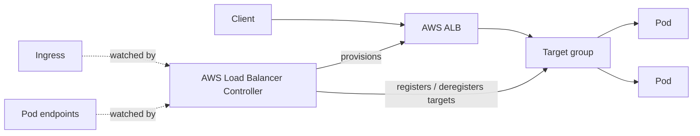
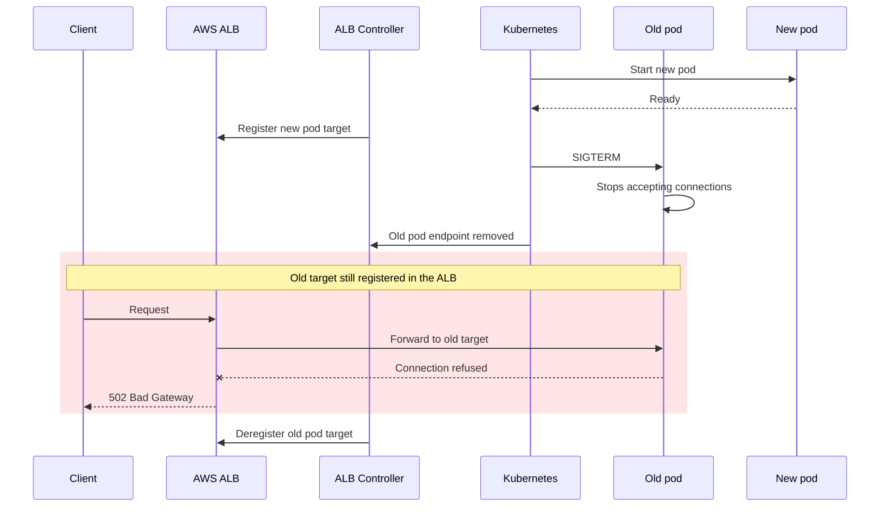

---
tags:
  - WIP
  - kubernetes
  - aws
date: 2024-07-22
title: Zero-downtime deployments behind AWS ALB Controller
---

This post dives into the initial setup for k8s releases as well as finally solving a long-present issue that has been present when rolling out changes.

## The setup

Our  setup involved the AWS ALB ingress controller which managed and provision respective loadbalancer resources based on events in k8s, and exposing our services to the world by creating said ingresses. The ingress controller would then update target routes as pods get cycled in and out. Sounds like a plan right?

## The problem

Even though we expected release rollouts to be zero-downtime, when performing releases we noticed that if we hit the services at the right time, there was a few second window where we would see `502 Bad Gateway`!

Pod shutdown and target deregistration happen independently, so the ALB can keep routing to a pod that has already stopped serving:

## The solution

## References

- 
